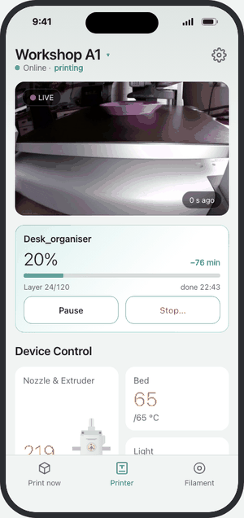
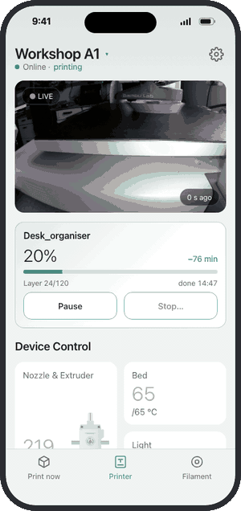
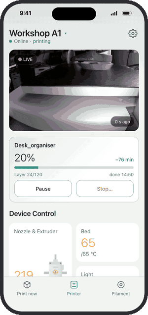
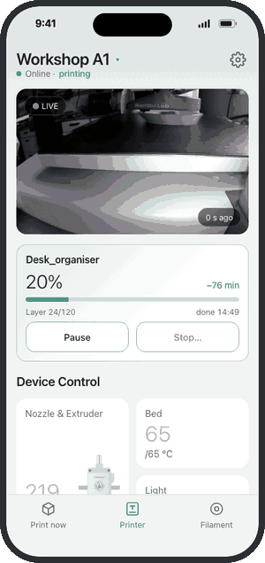
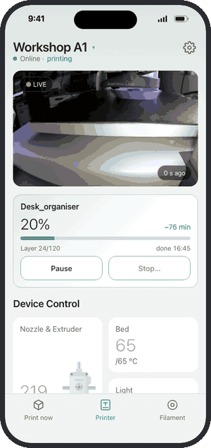

<h1 align="center">Pygmy</h1>

<p align="center">
  Your Bambu Lab and Klipper printers on your phone, <b>without the cloud</b>.<br>
  Live camera, controls, notifications, spaghetti detection and one-tap printing. Everything stays on your network.
</p>

<p align="center">
  
  
  
</p>

<p align="center"></p>

> [!NOTE]
> **Early preview.** Watch the first layers of every print and
> [open an issue](https://github.com/danderik88/pygmy/issues) when something looks off.

## 🚀 Install

Pygmy runs on an always-on computer on the same network as your printers.

**1. Prepare each printer**

- **Bambu Lab:** on the printer screen turn on **LAN-only mode** and **Developer Mode** (Settings, Network), and put a
  **USB stick or SD card (FAT32)** in it. Note the **access code** shown there.
- **Klipper:** nothing to do.

**2. Install Pygmy.** Pick where it runs:

<details>
<summary><b>Proxmox VE</b>: one command on the host, creates its own container</summary>

In the Proxmox web UI open the host's **Shell** and paste:

```sh
bash -c "$(curl -fsSL https://raw.githubusercontent.com/danderik88/pygmy/main/proxmox.sh)"
```

It creates a Debian container (2 cores, 4 GB RAM, 16 GB disk) that starts with the host, installs Docker and Pygmy in
it, and prints the link. Update: `pct exec <id> -- bash -c 'cd /opt/pygmy && git pull && ./install.sh'`

</details>

<details>
<summary><b>Any Linux</b>: mini PC, VM, Raspberry Pi (Debian, Ubuntu...)</summary>

```sh
sudo apt install -y git curl                     # Debian / Ubuntu
curl -fsSL https://get.docker.com | sudo sh      # skip if Docker is already installed
git clone https://github.com/danderik88/pygmy
cd pygmy && sudo ./install.sh
```

It prints the link at the end. Update: `cd pygmy && git pull && sudo ./install.sh`.

</details>

> [!IMPORTANT]
> **Raspberry Pi and other ARM computers: no Print now.** OrcaSlicer has no Linux ARM build, so Pygmy cannot slice
> there. Everything else works. To print from the app, use an x86 computer (an Intel N100 mini PC costs about the same).

The first install takes about 5 minutes. Tested from scratch on Proxmox VE 9, Debian 13, Ubuntu 25.04 and Debian 13
arm64. Docker Desktop (Mac, Windows) is not tested: use a Linux VM there.

**3. Open the link on your phone**, tap **+ Add printer** and pick your printer. Bambu Lab asks for the access code.

**4. Add it to the home screen** (Share, Add to Home Screen). Try **Print now** with a small STL.

> [!WARNING]
> Developer Mode turns off the printer's cloud login. Keep Pygmy on your home network and **never open its port to
> the internet**. For access from outside use Tailscale (see below).

## 👀 What it does

<table>
<tr>
<td align="center" width="33%"><br><b>Print now</b><br><sub>STL, 3MF, STEP or a Printables link. Sliced on your server, starts after your OK.</sub></td>
<td align="center" width="33%"><br><b>Add a printer</b><br><sub>Found on your network. Pick it, type the code, done.</sub></td>
<td align="center" width="33%"><br><b>Pause on spaghetti</b><br><sub>Watches the camera, pauses once and sends you a photo.</sub></td>
</tr>
<tr>
<td align="center"><br><b>Klipper too</b><br><sub>Any Moonraker printer: motion, lights, sensors, Print now.</sub></td>
<td align="center"><br><b>Several files, one plate</b><br><sub>A Printables page with many parts goes on one plate.</sub></td>
<td align="center"><br><b>AMS drying</b><br><sub>Start and stop drying (P2S, H2 with AMS 2 Pro).</sub></td>
</tr>
</table>

Also: Web Push and Telegram notifications with a photo, Home Assistant through MQTT, and an MCP server for AI agents.

**Tested on** A1, A1 mini, P1P, P1S, P2S (H2D: status, pause, stop), with AMS, AMS 2 Pro, AMS lite and BMCU.

## 🔧 More

<details>
<summary><b>Problems</b></summary>

Run these in the `pygmy` folder (on Proxmox: `pct enter <id>`, then `cd /opt/pygmy`).

- **Logs:** `docker compose logs -f bff`
- **Wrong address in the link:** `rm .env && ./install.sh 192.168.1.50` (your computer's IP).
- **Printer not in the list:** use **Enter IP** under **+ Add printer**.
- Your data lives in the `bff-data` Docker volume and survives updates.

</details>

<details>
<summary><b>Access from outside and notifications</b> (Tailscale)</summary>

Install [Tailscale](https://tailscale.com) on the computer, set `BFF_MCP_BIND` in `.env` to its Tailscale IP, run
`./install.sh`, then `sudo tailscale serve --bg http://<tailscale-ip>:8765`. The app is then at
`https://<machine>.<tailnet>.ts.net/app` from anywhere, and Web Push notifications work (they need HTTPS).

</details>

<details>
<summary><b>Spaghetti detection setup</b> (Obico ML API)</summary>

Run only the `ml_api` container from [obico-server](https://github.com/TheSpaghettiDetective/obico-server) (not the
Obico web server, and not `moonraker-obico` next to Pygmy). Then add to `.env` and run `./install.sh`:

```sh
BFF_OBICO_URL=http://<ml_api host>:3333
BFF_OBICO_TOKEN=<ML_API_TOKEN, if set>
BFF_OBICO_SENSITIVITY=medium   # low | medium | high
```

The `ml_api` host must reach Pygmy on port 8766. Pause on spaghetti is per printer (Options on the printer page, on by
default). Pygmy never resumes a print by itself.

To test without a real failure: put a spaghetti photo at `<state dir>/spaghetti/test-<printer alias>.jpg` during a
print; Pygmy uses it instead of the camera until you delete it.

</details>

<details>
<summary><b>Klipper details</b></summary>

Pygmy uses Moonraker's documented API. Print now slices from the printer's own `printer.cfg`, or from your OrcaSlicer
profiles (upload the preset bundle in the app). An ACE Pro shows up as a spool unit. One filament per print.

</details>

<details>
<summary><b>AI agents</b> (Claude Code or any MCP client)</summary>

The agent slices with an OrcaSlicer MCP server and hands the file to Pygmy, which shows the plate photo and starts only
after your OK. One token per agent: add `,agent=<48-char token>` to `BFF_MCP_TOKENS` in `.env`, then `./install.sh`.

```sh
claude mcp add --transport http bff http://<pygmy-ip>:8765/ --header "Authorization: Bearer <token>"
```

</details>

<details>
<summary><b>Moving the axes</b> (Expert mode)</summary>

Gear icon, **Advanced**, **Expert mode**, and `BFF_MCP_CONTROL=1` in `.env`. Only on the tested models. The printer
does not report the head position, so home first, clear the bed, stay next to it, and **never drive a P1 to X0 Y0**:
the head hits the filament cutter.

</details>

<details>
<summary><b>Without Docker</b></summary>

- Proxmox: systemd units in `deploy/`, `deploy/slicer/provision.sh` creates the slicer LXC.
- No root: `deploy/user/install.sh user@host` (systemd `--user`, OrcaSlicer flatpak, needs Tailscale and `uv`).

</details>

<details>
<summary><b>Not included: MakerWorld</b></summary>

MakerWorld downloads need a non-public account API. Download the model yourself and use Upload.

</details>

## 🙏 Thanks

- [OrcaSlicer](https://github.com/SoftFever/OrcaSlicer) (AGPL-3.0): Pygmy runs its unmodified command line and official
  profiles in a separate container; no OrcaSlicer code is copied.
- [go2rtc](https://github.com/AlexxIT/go2rtc) for the camera streams.
- [OpenBambuAPI](https://github.com/Doridian/OpenBambuAPI) and the community that documented the LAN interfaces.
- [tommasobbianchi](https://github.com/tommasobbianchi) for the Klipper backend, SV08 slicing and the rootless installer.
- [tlabcustomaudio](https://github.com/tlabcustomaudio) for H2D support, and the beta testers.

If Pygmy saved you a trip to the printer, you can [buy me a coffee](https://paypal.me/merighidaniel).
Contributing: tests with `python3 -m unittest discover -s tests`; only documented LAN interfaces.

## ⚖️ Disclaimer and license

Pygmy is independent and **not affiliated with Bambu Lab**. Printer names are trademarks of their owners, used only to
say which printers work. It uses only what the printers offer in LAN-only / Developer Mode (MQTT, FTPS, camera).

**Use at your own risk.** A printer heats up and moves: never leave a remote print completely unwatched. Provided as
is, without warranty. MIT license, see `LICENSE`.
