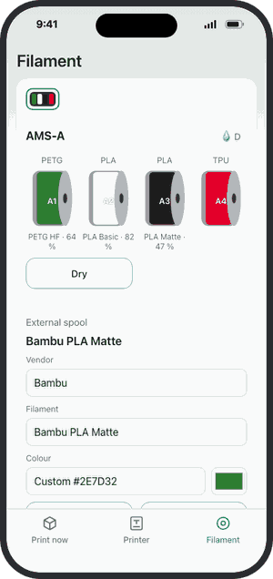

# Pygmy

Run your Bambu Lab printers **LAN-only** (and Klipper printers, work in progress) from your phone: live camera, controls, notifications and
"Print now" with server-side slicing. Everything stays on your network; no printer cloud account is used.

| Printer status | Print now | AMS drying | Add printer |
|:-:|:-:|:-:|:-:|
|  |  |  |  |

<sub>Recorded in the built-in simulator (`tools/sim`) with sample printers; the camera frames are real.</sub>

> **Work in progress.** Pygmy is a young project and changes often. Print now in particular is still under active
> development: we are fixing the remaining bugs one by one, so watch the first layers of every print and
> [open an issue](https://github.com/danderik88/pygmy/issues) when something looks wrong.

Status: early preview. Tested by hand on A1, A1 mini, P1P, P1S and P2S, with AMS, AMS 2 Pro and AMS lite.
H2D: read-only plus pause/resume/stop (contributed).

## Disclaimer

- Pygmy is an independent project. It is **not affiliated with, endorsed by or supported by Bambu Lab**.
  "Bambu Lab" and printer model names are trademarks of their owners, used only to say which printers Pygmy works with.
- Pygmy only uses the interfaces the printers offer in LAN-only / Developer Mode (MQTT, FTPS to the SD card or USB stick,
  camera). No vendor plugin, no cloud.
- **Use at your own risk.** The software is provided as is, without warranty (MIT license). A printer heats up and moves:
  never leave a print you started remotely completely unwatched. The authors are not liable for damage to printers,
  prints, property or warranty.
- Developer Mode turns off the vendor's cloud authentication. Keep the printers and Pygmy on a trusted network and
  **never expose Pygmy's port to the internet**; use Tailscale or a VPN for remote access.

## What it does

- **Web app** (installable on iPhone/Android): printer status, live camera with pinch to zoom, light, temperatures,
  speed, fans, motion, AMS and spools, AMS drying where the printer supports it, errors explained in plain words.
- **Print now**: upload an STL, 3MF or STEP file, or paste a Printables link; pick printer and spools (up to 16 colours);
  Pygmy slices it with the OrcaSlicer command line on your server and starts it after a plate photo and your OK.
  Per-printer queue and a Files screen.
- **Safety**: every action that moves or heats the printer is checked against the printer state and asks for a confirmation.
- **Notifications**: Web Push and Telegram (print done, failed, errors, low spool, printer offline).
- **Home Assistant**: entities and events through MQTT discovery, camera as RTSP.
- **AI agents**: an MCP server, so an agent can read the printers and, with your confirmation, start or stop prints.
- **Add printer** from the app: finds printers on the network; pair more phones with a QR code.

## Before you start

- Printers in **LAN-only mode with Developer Mode on** (printer screen: Settings, Network). Note each printer's
  **access code** (same screen).
- **A USB stick or SD card (FAT32) in every printer.** Pygmy sends prints to it over FTPS. P2S and H2 series keep files in
  internal memory that only the vendor software can reach, so they need one too.
- An always-on **Linux x86_64** machine on the same network (mini PC, NAS, VM) with
  [Docker](https://docs.docker.com/engine/install/). No Proxmox needed.
  On a Raspberry Pi / ARM, Pygmy runs but Print now does not (OrcaSlicer has no Linux ARM build).

## Install (Docker)

```sh
git clone https://github.com/danderik88/pygmy && cd pygmy
cp .env.example .env
sed -i "s/CHANGE_ME_IP/192.168.1.50/" .env          # <- this machine's IP (or its Tailscale IP)
for k in TOKEN SLICER RTSP; do sed -i "s/CHANGE_ME_$k/$(openssl rand -hex 24)/" .env; done
docker compose up -d --build                         # first build ~5 min (downloads OrcaSlicer)
echo "http://$(grep ^BFF_MCP_BIND= .env | cut -d= -f2):8765/app#k=$(grep ^BFF_MCP_TOKENS= .env | cut -d= -f3)"
```

Open the printed link on your phone, then:

1. **Add printer**: Pygmy lists the printers it hears on the network; pick one and type its access code.
2. Add the app to the home screen (Share, Add to Home Screen). Pair more phones from the app with a QR code.
3. Try **Print now** with a small STL.

ARM / no Print now: `docker compose up -d --build bff go2rtc`.
Update: `git pull && docker compose up -d --build`. Logs: `docker compose logs -f bff`.
The printers, queue and files live in the `bff-data` volume.

### Remote access and notifications (optional)

Install [Tailscale](https://tailscale.com) on the machine, set `BFF_MCP_BIND` to its Tailscale IP, then
`sudo tailscale serve --bg http://<tailscale-ip>:8765`. The app is then at `https://<machine>.<tailnet>.ts.net/app`
from anywhere, and Web Push notifications work (they need HTTPS).

### Without Docker

- Proxmox: `deploy/` holds the systemd units (`bff-mcp.service`, `go2rtc.service`) and `deploy/slicer/provision.sh`
  creates the slicer as an LXC container. Same settings as `.env.example`.
- Advanced, no root: `deploy/user/install.sh user@host` installs Pygmy and the slicer as `systemd --user` services with the
  OrcaSlicer flatpak (needs Tailscale, `uv` and a display on the host).

## Klipper printers (work in progress)

Pygmy also drives Klipper printers through Moonraker's documented HTTP API: status, pause / resume / cancel,
temperatures, chamber light, webcam still, Print now with OrcaSlicer's own profile. An ACE Pro shows up as a spool unit.
Supported so far: Sovol SV08 (`KLIPPER-SV08`) and IdeaFormer IR3 V2 (`KLIPPER-IR3V2`, conservative temperature limits).
One filament per print. **Adding them from the app is not done yet**: add an entry to `printers.json` in the data
volume and restart Pygmy:

    "sv08": {"host": "192.168.1.60", "port": 7125, "name": "SV08", "model": "KLIPPER-SV08", "api_key": ""}

## Moving the axes (Expert mode)

Day-to-day printing never needs it. To jog the head by hand: gear icon, **Advanced**, **Expert mode**. A **Motion**
card appears on the printer screen (home first, then move in small steps). Only on models tested so far
(A1, A1 mini, P1P, P1S, P2S) and only with `BFF_MCP_CONTROL=1`.

Be careful: the printer does not report the head position over LAN, so Pygmy only knows it after homing and
cannot see what is on the bed. Clear the bed, stay next to the printer, and never drive a P1 into its front-left
corner (X0 Y0): the head hits the filament cutter.

## Printing: two ways

| You have | How you print |
|---|---|
| **No agent** | **Print now** in the app. Pygmy slices on your server and asks for your OK. Works today. |
| **An AI agent** (Claude Code or any MCP client) | The agent slices with an OrcaSlicer MCP server of your choice and hands the file to Pygmy's MCP; Pygmy shows the plate photo and starts only after your OK. |

Connect an agent to Pygmy (one token per agent: add `,agent=<another 48-char token>` to `BFF_MCP_TOKENS` and restart):

```sh
claude mcp add --transport http bff http://<bff-ip>:8765/ --header "Authorization: Bearer <token>"
```

> **Work in progress: "Print now" with your agent.** Pick a model in the app and your own agent slices it instantly,
> with your OrcaSlicer profiles, instead of the server. Not in this build yet.

## Not included

MakerWorld links: downloading from MakerWorld needs a sign-in through a non-public account API, so this build leaves it out.
Download the model from MakerWorld yourself and use Upload.

## Thanks

- [OrcaSlicer](https://github.com/SoftFever/OrcaSlicer) (AGPL-3.0): Pygmy runs its unmodified command line and its official
  Bambu Lab profiles in a separate container; no OrcaSlicer code is copied into Pygmy.
- [go2rtc](https://github.com/AlexxIT/go2rtc) for the camera streams.
- [OpenBambuAPI](https://github.com/Doridian/OpenBambuAPI) and the community that documented the LAN interfaces.
- [tommasobbianchi](https://github.com/tommasobbianchi) for the Klipper/Moonraker backend, SV08 slicing and the rootless installer.
- [tlabcustomaudio](https://github.com/tlabcustomaudio) for H2D support, and the beta testers for their patience and feedback.

## Support

If Pygmy saved you a trip to the printer, you can [buy me a coffee](https://paypal.me/merighidaniel).
Bug reports and tests on printers we don't have help just as much.

## Development

Tests: `python3 -m unittest discover -s tests`. Pull requests welcome; only documented LAN interfaces
(no vendor plugin, no reimplemented proprietary protocols).

## License

MIT, see `LICENSE`.
